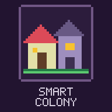

<p align="center"></p>

# Smart Colony

[](README.md)
[](README.md)
[](README.md)
[](README.md)
[](LICENSE)

Turns a vanilla village into a self-managing colony: categorized storage, lumberjacks, miners, farmers, fishermen, herders, builders, roads, torches, guards, golems, an internal market and theft detection. Singleplayer.

> **Эксперимент.** Smart Colony — экспериментальный проект по изучению того, как ИИ работает в Minecraft. Поведение колонии может меняться от версии к версии, а старые миры могут вести себя иначе после обновления.
>
> **Experiment.** Smart Colony is an experimental project studying how AI works in Minecraft. Colony behaviour may change between versions, and existing worlds may behave differently after an update.

**Руководство / User guide:** [Русский](docs/USER_GUIDE_RU.md) · [English](docs/USER_GUIDE_EN.md)

## Русский

### Что это

`Smart Colony` (mod id `smartcolony`) — Fabric-мод для Minecraft 26.3, рассчитанный на одиночную игру. Обычная деревня превращается в колонию, которая живёт сама: жители получают профессии, добывают ресурсы, складывают их на общий склад, строят дома, прокладывают дороги, ставят фонари и защищаются. Любое действие колонии оплачивается реальными предметами со склада — ничего не появляется из воздуха (кроме стартового склада при основании).

### Возможности

Подробное описание каждой системы: [справочник возможностей](docs/USER_GUIDE_RU.md#справочник-возможностей).

| Раздел | Что происходит |
|---|---|
| Основание и склад | Колония основывается сама у колокола при 3 взрослых жителях или командой. Склад из 5 столбиков бочек по категориям, навес при заполнении 75–90% |
| Роли | Колония распределяет роли по запасам и нуждам, с учётом ванильной профессии. Смена с 1000 до 10500 тиков дня |
| Добыча | Лесорубы и питомник деревьев, шахтёры, карьеры, разведчики и старатели, выносные склады и носильщики |
| Еда | Фермеры, рыбаки, пастухи с загонами, таверна и трактирщик, обед и вечерний сбор |
| Стройка | Постройка по чертежам из материалов склада, расчистка и террасы, съёмка местности, ремонт, улучшение домов, пирсы и дома на воде |
| Посёлок | Гостиница в пять этапов, дороги, фонари, стена с башнями, мастерские, школа, рынок, радиус до 112 блоков |
| Жители | Рождение детей, опыт ролей (уровни 1–5), распорядок дня, праздники, укрытие от дождя, огня и лавы |
| Оборона | Тревога и закрытые комнаты, хранитель дверей, стражники, казармы, железные големы, действия при набегах и пожарах |
| Экономика | Внутренний рынок за изумруды по настоящим сделкам жителей, учёт краж, репутация игрока |
| Соседи | Мнения колоний, послы, договоры, караваны, дороги между колониями, войны и перемирия |
| Указы | Упор колонии, запретные зоны, заказы предметов |
| ИИ-советник | Необязателен, по умолчанию выключен: локальная модель через Ollama или OpenAI-совместимый API поправляет не больше трёх ролей, заказывает постройки, крафт и спасение жителей |

### Управление

- клавиша **K** (меняется в настройках управления) или `/colony` — окно колонии с вкладками «Обзор», «Склад», «Жители», «Журнал», «Рынок», «Указы», «Соседи»; `/colony stock`, `/colony journal`, `/colony market` открывают нужную вкладку;
- `/colony info` — то же окно на вкладке «Обзор»: жители по ролям, заполнение складов, запас еды, стройка и чего не хватает, шахта, ваша репутация (если на клиенте нет мода, ответы этих команд приходят в чат);
- `/colony found` — основать колонию у ближайшего колокола;
- `/colony found here` — поставить склад прямо перед собой (по голограмме);
- `/colony reputation` — ваша репутация у колонии;
- `/colony build <чертёж>` — заказать постройку (`house_small`, `house_family`, `house_garden`, `storage_shed`, `guard_post`, `pen`, `blacksmith`, `market`, `barn`, `watchtower`, `chapel`);
- `/colony ai` — состояние ИИ-советника и его последние мысли; `/colony ai on|off` — включить или выключить его для этой колонии, `/colony ai now` — спросить сразу, `/colony ai reload` — перечитать конфиг;
- `/colony role <жители> <роль|auto>` — закрепить роль (`lumberjack`, `miner`, `farmer`, `fisherman`, `herder`, `builder`, `guard`, `idle`) или вернуть автоматический выбор;
- `/colony decree focus <balanced|food|defense|build|resources>` — указ об упоре колонии; `/colony decree zone add [радиус]`, `remove`, `list` — запретные зоны; вкладка «Указы» в окне колонии делает то же кнопками;
- `/colony order <предмет> <количество>` — заказать предметы у колонии, `/colony order list` и `/colony order cancel` — список и отмена;
- `/colony relations` — отношения с соседями; `/colony diplomacy policy <auto|peaceful|warlike>` — внешняя политика; `/colony diplomacy envoy <колония>` — отправить посла (с дарами или подходящим предложением), `peace <колония>` — просить мира, `war <колония>` и `raid <колония>` — объявить войну и отправить набег;
- `/colony disband` — распустить колонию (жители возвращаются к ванильному поведению, постройки остаются).

### Настройки

Файл `config/smartcolony.json` создаётся при первом запуске. Полный список: [настройки](docs/USER_GUIDE_RU.md#настройки).

- **Колония:** авто-основание, минимум жителей, радиус и его максимум, начало и конец смены, скорость стройки.
- **Работы:** глубина шахты, плотность и радиус леса, лимит животных, период рынка, порог «дерева достаточно».
- **Защита:** цена и число големов, порог отступления стражи, атака стражей на врагов-игроков.
- **Интерфейс:** подписи ролей над жителями, сообщения в чат.
- **ИИ-советник:** `aiEnabled`, `aiApi`, `aiEndpoint`, `aiModel`, `aiApiKey`, `aiLanguage`, `aiIntervalTicks`, `aiTimeoutSeconds`, разрешения `aiCan*`.
- **Данные колоний:** `<мир>/smartcolony/colonies.json` и резервная копия `.bak`.

### Установка

Положите `smart-colony-1.0.1.jar` в папку `mods` профиля Minecraft 26.3 с Fabric Loader и Fabric API.

**Требования:** Minecraft 26.3, Fabric Loader 0.19.3+, Fabric API, Java 25.

### Сборка

```
.\gradlew.bat clean build
```

Готовый файл: `build/libs/smart-colony-1.0.1.jar`.

### Для разработки: MCP-мост

Отладочный мод `smartcolony_devbridge` в `src/devbridge` не попадает в релизный jar. Запуск и удаление описаны в разделе [MCP-мост для разработки](docs/USER_GUIDE_RU.md#mcp-мост-для-разработки).

---

## English

### What It Is

`Smart Colony` (mod id `smartcolony`) is a Fabric mod for Minecraft 26.3 meant for singleplayer. It turns an ordinary village into a colony that runs itself: villagers take jobs, gather resources into a shared storage, build houses, lay roads, put up street lights and defend themselves. Every colony action is paid for with real items from the storage — nothing is spawned except the starter storage when the colony is founded.

### Features

A detailed description of every system: [feature reference](docs/USER_GUIDE_EN.md#feature-reference).

| Area | What happens |
|---|---|
| Founding and storage | A colony founds itself at the bell with 3 adults, or by command. A storage of 5 barrel columns by category, plus a shed at 75–90% fill |
| Roles | The colony assigns jobs from its stock and needs, preferring vanilla professions. The shift runs from day tick 1000 to 10500 |
| Gathering | Lumberjacks and a tree nursery, miners, quarries, scouts and prospectors, outposts and porters |
| Food | Farmers, fishermen, herders with pens, a tavern and innkeeper, lunch and an evening gathering |
| Building | Blueprints built from storage materials, clearing and terraces, terrain survey, repairs, house upgrades, piers and houses on water |
| Settlement | A five-stage inn, roads, street lights, a wall with towers, workshops, a school, a market, a radius up to 112 blocks |
| Villagers | Children, role experience (levels 1-5), a daily routine, festivals, shelter from rain, fire and lava |
| Defence | Alarm and closed rooms, a door keeper, guards, barracks, iron golems, response to raids and fires |
| Economy | An internal market for emeralds through real villager trades, theft tracking, player reputation |
| Neighbours | Colony opinions, envoys, treaties, caravans, roads between colonies, wars and truces |
| Decrees | Colony focus, no-build zones, item orders |
| AI advisor | Optional, off by default: a local model through Ollama or an OpenAI-compatible API fixes at most three roles and orders buildings, crafting and rescues |

### Controls

- key **K** (rebindable in Controls) or `/colony` — colony window with Overview, Storage, Villagers, Journal, Market, Decrees and Neighbours tabs; `/colony stock`, `/colony journal`, `/colony market` open the matching tab;
- `/colony info` — the same window on the Overview tab: members by role, storage fill, food, construction and what it lacks, mine, your reputation (without the mod on the client these commands answer in chat);
- `/colony found` — found a colony at the nearest bell;
- `/colony found here` — place the storage right in front of you (follow the hologram);
- `/colony reputation` — your reputation with the colony;
- `/colony build <blueprint>` — order a building (`house_small`, `house_family`, `house_garden`, `storage_shed`, `guard_post`, `pen`, `blacksmith`, `market`, `barn`, `watchtower`, `chapel`);
- `/colony ai` — AI advisor status and its latest thoughts; `/colony ai on|off` — turn it on or off for this colony, `/colony ai now` — ask right away, `/colony ai reload` — reload the config;
- `/colony role <villagers> <role|auto>` — lock a role (`lumberjack`, `miner`, `farmer`, `fisherman`, `herder`, `builder`, `guard`, `idle`) or return to automatic choice;
- `/colony decree focus <balanced|food|defense|build|resources>` — colony focus decree; `/colony decree zone add [radius]`, `remove`, `list` — no-build zones; the Decrees tab in the colony window does the same with buttons;
- `/colony order <item> <count>` — order items from the colony, `/colony order list` and `/colony order cancel` — list and cancel;
- `/colony relations` — relations with the neighbours; `/colony diplomacy policy <auto|peaceful|warlike>` — foreign policy; `/colony diplomacy envoy <colony>` — send an envoy (gifts or a fitting proposal), `peace <colony>` — sue for peace, `war <colony>` and `raid <colony>` — declare war and send a raid;
- `/colony disband` — disband the colony (villagers return to vanilla behaviour, buildings stay).

### Configuration

`config/smartcolony.json` is created on first launch. Full list: [settings](docs/USER_GUIDE_EN.md#settings).

- **Colony:** auto-founding, minimum villagers, radius and its maximum, shift start and end, build speed.
- **Jobs:** mine depth, forest density and radius, animal cap, market period, "enough wood" threshold.
- **Defence:** golem price and count, guard retreat threshold, guards attacking enemy players.
- **Interface:** role names above villagers, chat messages.
- **AI advisor:** `aiEnabled`, `aiApi`, `aiEndpoint`, `aiModel`, `aiApiKey`, `aiLanguage`, `aiIntervalTicks`, `aiTimeoutSeconds`, `aiCan*` permissions.
- **Colony data:** `<world>/smartcolony/colonies.json` and a `.bak` copy.

### Installation

Put `smart-colony-1.0.1.jar` into the `mods` folder of a Minecraft 26.3 profile with Fabric Loader and Fabric API.

**Requirements:** Minecraft 26.3, Fabric Loader 0.19.3+, Fabric API, Java 25.

### Building

```
.\gradlew.bat clean build
```

Output: `build/libs/smart-colony-1.0.1.jar`.

### Development: MCP bridge

The debug mod `smartcolony_devbridge` in `src/devbridge` is not part of the release jar. Running and removing it is covered in [MCP bridge for development](docs/USER_GUIDE_EN.md#mcp-bridge-for-development).

## Лицензия / License

MIT — см. [LICENSE](LICENSE).
